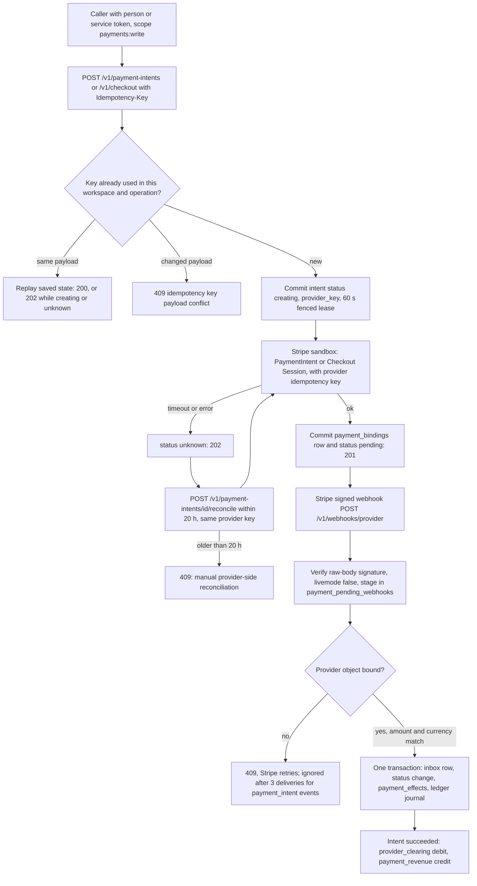
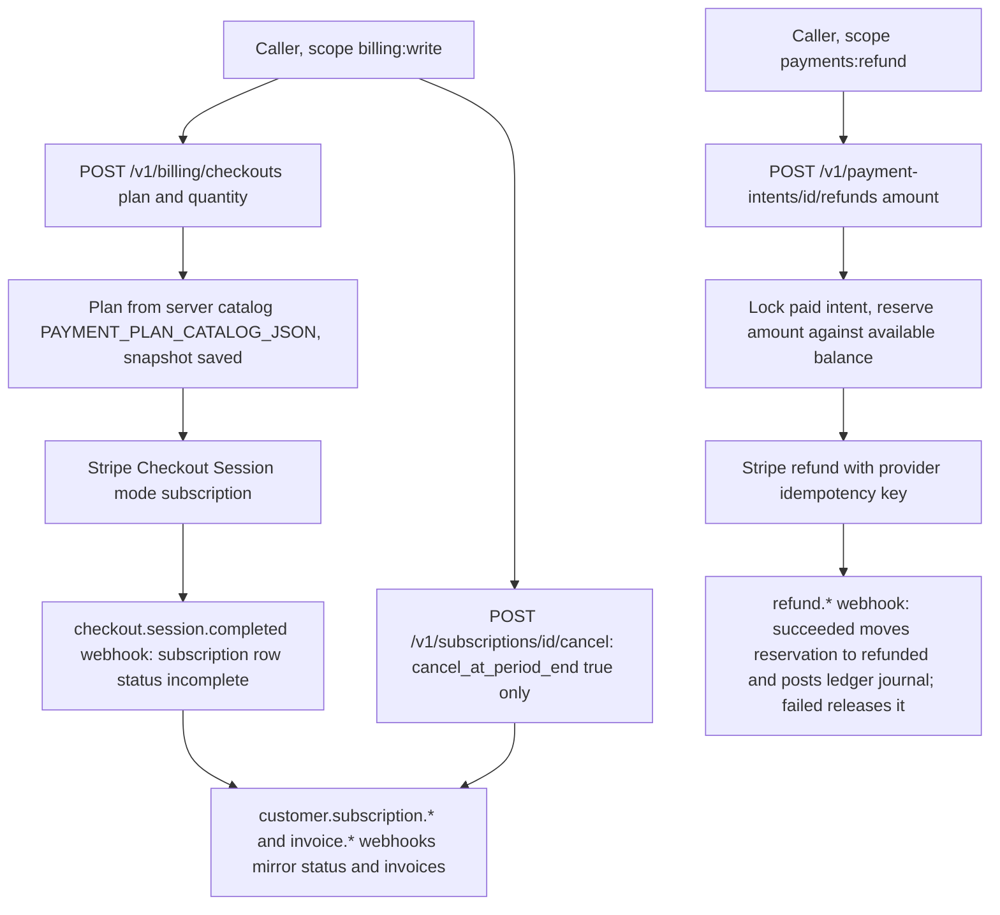

# 01 — Business process (As-Is / To-Be)

repo นี้คือ platform boundary ของ capability `payment` (payment intent, checkout, billing, ledger, reconciliation) ตาม `contract.json`
runtime v1 ใน `src/platform_payment` เป็น **test-mode only** (Stripe sandbox) และ hosted บน Railway แล้วแต่ `/readyz` ยัง 503 เพราะยังไม่มี sandbox key (ดู 16)
งานจ่ายเงินจริง (live Stripe) ยังอยู่ที่ระบบเดิม: `infra/api/stripe.ts` / `infra/api/server.ts` ใน `solo-empire` และ live webhook อยู่ที่ `bookchaowalit/platform-webhooks-worker` (owner decision D8)

## As-Is: one-time payment (จากโค้ดวันนี้)

Sources: `src/platform_payment/app.py`, `src/platform_payment/adapters.py`, `src/platform_payment/event_router.py`, `src/platform_payment/payment_events.py`, `src/platform_payment/pending_webhooks.py`, `src/platform_payment/ledger.py`, `docs/runtime.md`

## As-Is: subscription billing และ refund

Sources: `src/platform_payment/billing_checkouts.py`, `src/platform_payment/catalog.py`, `src/platform_payment/subscriptions.py`, `src/platform_payment/billing_events.py`, `src/platform_payment/stripe_events.py`, `src/platform_payment/stripe_billing.py`, `src/platform_payment/refunds.py`, `docs/billing-runtime.md`

## To-Be

แหล่ง To-Be ที่มีใน repo: `docs/runtime.md` §Staging plan (not executed), `docs/UPGRADE-PLAN.md` backlog, `README.md` §Migration gate และ `contract.json` `migration` (shadow_parity / cutover = `pending`)

```mermaid
flowchart LR
  S1["Owner decision D8 stays: live Stripe on platform-webhooks-worker"] --> S2["Staging on Stripe sandbox only"]
  S2 --> S3["Back up, migrate 001 to 003 as NOSUPERUSER owner"]
  S3 --> S4["Inject rk_test key, webhook secret, HTTPS return URLs; readyz 200"]
  S4 --> S5["Negative check: live-shaped key refuses start"]
  S5 --> S6["Sandbox parity: intents, checkout, async methods, refunds, subscriptions"]
  S6 --> S7["Ledger reconcile per intent and forced posting failure"]
  S7 --> S8["Rollback rehearsal: restore backup, re-apply 003"]
  S8 --> S9["Evidence in parent registry"]
  S9 --> S10["Cutover or live activation: separate owner decision"]
```

Sources: `docs/runtime.md` §Staging plan, `README.md` §Migration gate, `contract.json` (`migration`, `migration_gates`), `docs/CONTRACT-SURFACE.md` §Migration gates

## Open questions

- Cutover criteria ของ runtime ยังเป็น `[ต้องยืนยัน]` ใน `PRODUCT.md` §Measures
- `POST /api/webhook/revenue` (ledger candidate) จะย้ายมาที่ platform นี้หรือไม่ (`docs/UPGRADE-PLAN.md` P0) ยังไม่มีคำตอบ
- ใครคือ consumer จริงคนแรกของ v1 API (นอกจาก MCP hub แบบ read-only) ไม่พบใน repo
- capability `reconciliation` ใน `contract.json` ยังไม่มีโค้ด financial reconciliation (runtime ทำเฉพาะ provider-creation reconcile; `docs/runtime.md` บอกว่า "does not implement ... financial reconciliation")
