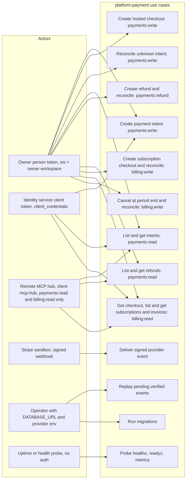

# 02 — Use cases

Actors คือสิ่งที่ service ตรวจจริง: RS256 token จาก platform identity (issuer + audience `payment-api`, claim `ws` = workspace, `sub` = actor, `scope`), ลายเซ็น Stripe บน webhook และ operator ที่ถือ DB credential สำหรับ CLI
ไม่มีการแยก "person token" กับ "service client token" ในโค้ด: `TokenVerifier.verify` คืน `Principal(actor, workspace, scopes)` เหมือนกันทั้งสองแบบ ความต่างอยู่ที่ scope ที่ identity ออกให้

Sources: `src/platform_payment/app.py`, `billing_checkouts.py`, `subscriptions.py`, `refunds.py`, `__main__.py`, platform-backend-core `21d5f44` `src/platform_backend_core/auth.py` + `http.py` (`require_scope`), `API.md` §Authentication + §Callers, ops record: book-platforms-status (2026-11-03)

## Scope → permission (identity side)

| Scope | Permission (identity) | ใช้ที่ |
|---|---|---|
| `payments:read` | `payment.payment:read` | GET intents, GET refunds |
| `payments:write` | `payment.payment:write` | POST intents, checkout, intent reconcile |
| `payments:refund` | `payment.refund:write` | POST refunds, refund reconcile |
| `billing:read` | `payment.billing:read` | GET billing checkout, subscriptions, invoices |
| `billing:write` | `payment.billing:write` | POST billing checkout, reconcile, cancel, cancel reconcile |

Sources: `API.md` §Authentication, ops record: book-platforms-status (2026-11-03) (audience `payment-api` + 5 scopes, owner granted)

## Authorization rules ในโค้ด

- ไม่มี token / token ผิด → 401 (`WWW-Authenticate: Bearer`); ไม่มี scope → 403; ID ของ workspace อื่น → 404 (RLS ซ่อนแถว)
- token ที่มี claim `del` หรือ `obo` ถูกปฏิเสธ (core ไม่รองรับ delegation)
- webhook ไม่ใช้ JWT: authority คือ Stripe signature + binding ที่บันทึกไว้; metadata ใน event ไม่เคยใช้เลือก workspace

## Open questions

- service client ตัวใดบ้าง (นอกจาก `mcp-hub`) ได้ scope ของ `payment-api` จาก identity: ใน ops record มีแค่ hub แบบ read-only; "SVC" ในภาพจึงเป็นความสามารถของโค้ด ไม่ใช่ client ที่ยืนยันแล้ว
- person token ยังใช้ไม่ได้จนกว่า owner ตั้ง `IDENTITY_GOOGLE_CLIENT_IDS` (ops record)
