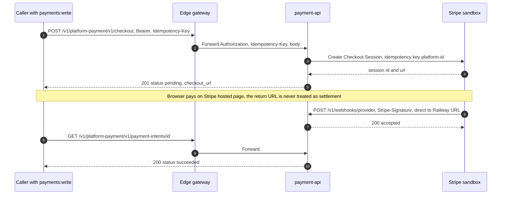
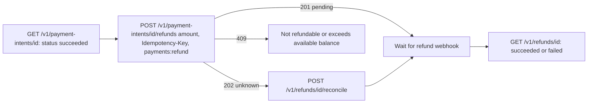
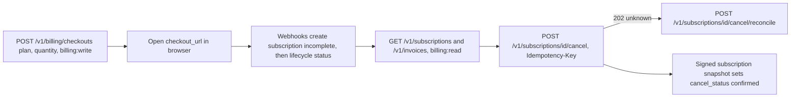
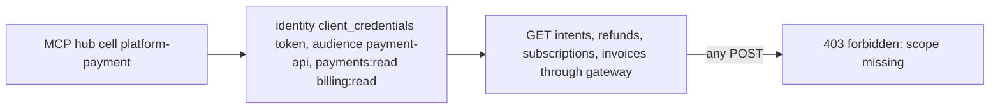
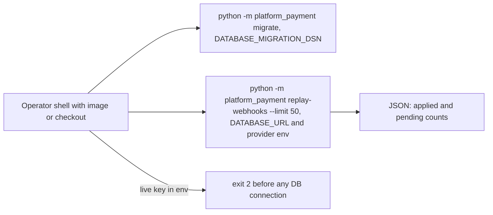

# 03 — User flows (API call flows per caller)

ไม่มี UI ใน repo นี้ "user flow" คือลำดับ API call ของแต่ละ caller ผ่าน edge gateway (`https://gateway.bookchaowalit.com/v1/platform-payment/...`) หรือ Railway URL ตรง

## Flow A — Write caller: one-time payment ถึง settlement

ถ้าขั้น 3 timeout: ได้ 202 `status=unknown` แล้วเรียก `POST /v1/payment-intents/{id}/reconcile` (ห้ามใช้ Idempotency-Key ใหม่)

## Flow B — Refund caller

## Flow C — Billing caller

## Flow D — MCP hub (read-only)

## Flow E — Operator

Sources: `src/platform_payment/app.py`, `refunds.py`, `billing_checkouts.py`, `subscriptions.py`, `__main__.py`, `pending_webhooks.py`, `API.md`, `docs/billing-runtime.md`, platform-api-gateway `c7b16d1` `API.md` + `src/book_api_gateway/edge.py` (`FORWARD_REQUEST` ไม่รวม `Stripe-Signature`, edge route ต้องมี Bearer), ops record: book-platforms-status (2026-11-03)

## Open questions

- Stripe webhook จะชี้ไปที่ Railway URL ตรง (gateway ต้องการ Bearer และไม่ส่ง `Stripe-Signature` ต่อ) หรือจะมี route เฉพาะ: ยังไม่ได้ลงทะเบียน endpoint ใด
- `replay-webhooks` ยังไม่มี schedule (`docs/billing-runtime.md`: "Schedule with backoff through the owning deployment") ไม่พบ cron ใน Railway project
