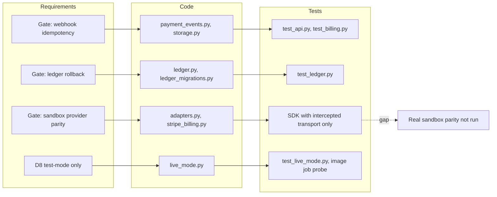

# 04 — Traceability (RTM)

ไม่มี `specs/` ใน repo requirement มาจาก `PRODUCT.md`, `contract.json` (`interfaces`, `migration_gates`), `docs/runtime.md` และ `docs/billing-runtime.md`
Release: ไม่มี tag หรือ GitHub release; "workflow" = job ที่รันการทดสอบนั้น

| ID | Requirement (source) | Code module | Test file | CI job |
|---|---|---|---|---|
| R1 | contract valid against pinned schema (`PRODUCT.md` Success) | `scripts/check.py`, `scripts/check_schema_pin.py` | `tests/test_contract_check.py`, `tests/test_drift_checks.py` | `check.yml` `contract` (3.11, 3.12) + `python` |
| R2 | registry alignment (`PRODUCT.md` Measures) | `scripts/check_registry_alignment.py` | `tests/test_drift_checks.py` | `contract`, `python` (offline only; real registry check is local) |
| R3 | every provided HTTP interface declares auth; no secrets in contract | `contract.json` | `tests/test_payment_boundary.py` | `contract`, `python` |
| R4 | `payment.http.v1-runtime`: intents, checkout, idempotency, tenant isolation | `app.py` | `runtime_tests/test_api.py` | `python` (PostgreSQL 16) |
| R5 | webhook signature, raw body, 300 s, livemode false | `adapters.py` `verify_event` | `runtime_tests/test_api.py` (`test_stripe_signature_raw_body_livemode_and_checkout_payment_status`) | `python` |
| R6 | gate "webhook idempotency": dedupe, out-of-order, concurrency | `payment_events.py`, `storage.py` `inbox` | `runtime_tests/test_api.py`, `test_billing.py` | `python` |
| R7 | ambiguous outcome → unknown, reconcile ≤ 20 h | `app.py` `perform`/`reconcile`, `provider_operations.py` | `test_api.py` (`test_timeout_...`, `test_concurrent_reconcilers_...`), `test_refunds.py`, `test_billing.py` | `python` |
| R8 | `payment.table.workspace-state`: FORCE RLS, restricted role | `migrations.py`, `billing_migrations.py` | `test_api.py`, `test_readiness_grants.py` | `python` |
| R9 | `/readyz` needs provider, grants, migrations, RLS | `app.py` `readiness` | `test_api.py` (`test_readiness_...`), `test_readiness_grants.py` | `python` |
| R10 | `payment.table.ledger` + gate "ledger rollback" | `ledger.py`, `ledger_migrations.py` | `runtime_tests/test_ledger.py` | `python` |
| R11 | `payment.http.billing`: catalog, subscriptions, invoices, cancel | `billing_checkouts.py`, `subscriptions.py`, `billing_events.py`, `catalog.py` | `runtime_tests/test_billing.py`, `test_stripe_billing.py` | `python` |
| R12 | `payment.http.refunds`: reservation, no over-refund | `refunds.py` | `runtime_tests/test_refunds.py`, `test_ledger.py` | `python` |
| R13 | `payment.cli.webhook-replay` | `pending_webhooks.py`, `__main__.py` | `test_billing.py` (`test_events_before_binding_...`) | `python` |
| R14 | test-mode only (D8) | `live_mode.py`, `config.py`, `__main__.py` | `runtime_tests/test_live_mode.py`, `test_review_fixes.py` | `python` + `shared-runtime.yml` `image` (live-key probe) |
| R15 | Sentry errors only, no free text | `_sentry.py` | `runtime_tests/test_sentry.py` | `python` |
| R16 | clean-checkout multi-stage image, non-root, SHA-pinned actions | `Dockerfile`, workflows | `tests/test_build_hygiene.py` | `contract`, `python`, `image` |
| R17 | gate "sandbox provider parity" | `adapters.py`, `stripe_billing.py` | `test_api.py` / `test_stripe_billing.py` use real SDK with intercepted transport only | none: needs a real sandbox (gap) |
| R18 | legacy `payment.http.stripe-webhook`, `webhook-log`, `revenue-webhook`, `identity-bearer` | `solo-empire` `infra/api/server.ts`, `auth.ts` (not in this repo) | none here | none (gap; `docs/UPGRADE-PLAN.md` P0 parity fixtures) |

Sources: `PRODUCT.md`, `contract.json`, `docs/runtime.md`, `docs/billing-runtime.md`, `docs/UPGRADE-PLAN.md`, `runtime_tests/*.py`, `tests/*.py`, `.github/workflows/check.yml`, `.github/workflows/shared-runtime.yml`

## Open questions

- `PRODUCT.md` อ้าง `fixtures/gates/` แต่ไม่มีโฟลเดอร์นี้ใน repo
- `docs/UPGRADE-PLAN.md` (score 6/10, "no runtime implementation") ล้าหลังโค้ดปัจจุบัน
- ไม่มี release/tag: ไม่สามารถผูก requirement กับ version ที่ deploy ได้ (Railway deploy เป็น CLI upload ไม่มี commit hash; ดู 22)
