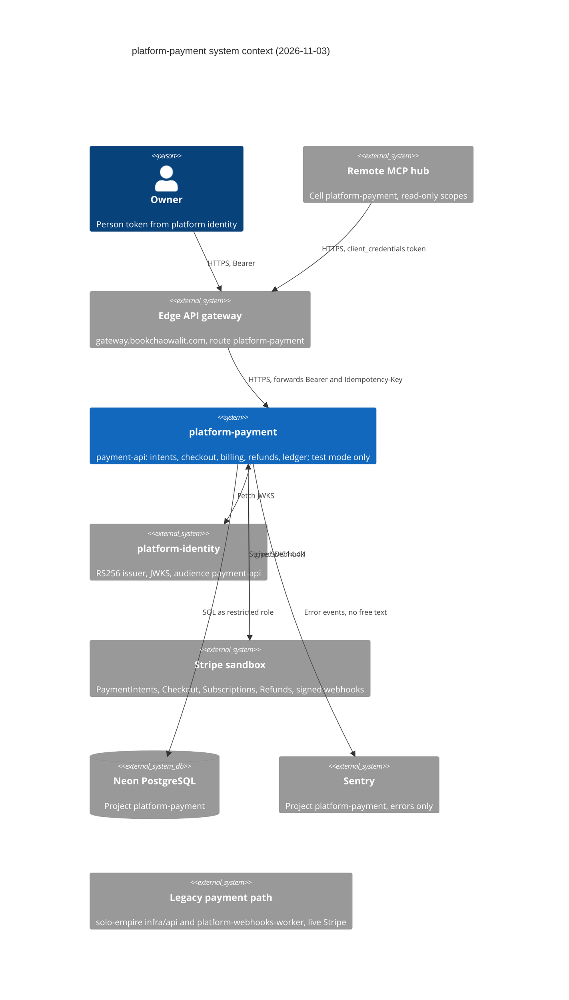

# 05 — C4 Context

Sources: `API.md`, `src/platform_payment/__main__.py`, `adapters.py`, `stripe_billing.py`, `_sentry.py`, `docs/runtime.md` §Test-mode only, `docs/CONTRACT-SURFACE.md`, `pyproject.toml`, ops record: book-platforms-status (2026-11-03)

หมายเหตุ: `legacy` ไม่มีเส้นเชื่อมกับ platform-payment เลย (ไม่มี import หรือ call ระหว่างกัน) เป็นระบบที่ live อยู่และจะถูกแทนเมื่อ cutover; Stripe webhook ยังไม่ได้ลงทะเบียนชี้มา service นี้

## Open questions

- service ไหนจะเรียก payment-api แบบ write เป็นรายแรก (commerce? offers cell?) ไม่พบใน repo
