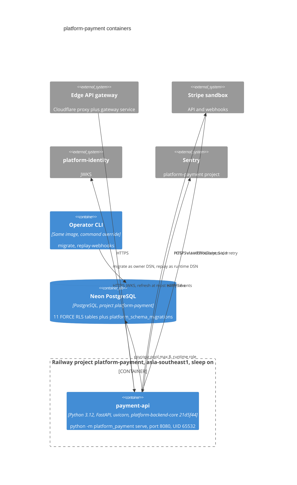

# 06 — C4 Container

Sources: `Dockerfile`, `src/platform_payment/__main__.py`, `adapters.py`, `migrations.py`, `billing_migrations.py`, `ledger_migrations.py`, `_sentry.py`, platform-backend-core `21d5f44` `auth.py` (`_JWKS`) + `db.py`, Railway API read 2026-11-03 (service `payment-api`: Dockerfile builder, 1 replica `asia-southeast1-eqsg3a`, `sleepApplication` true, healthcheck `/healthz`), ops record: book-platforms-status (2026-11-03) (Neon `platform-payment`, role `payment_runtime`)

## Open questions

- ยังไม่มี Railway cron service สำหรับ `replay-webhooks`; CLI ในภาพคือการรันด้วยมือ
- `migrate` รันจากที่ใดสำหรับ hosted DB (local `git archive` หรือ `railway run`) ไม่มีบันทึกใน repo
