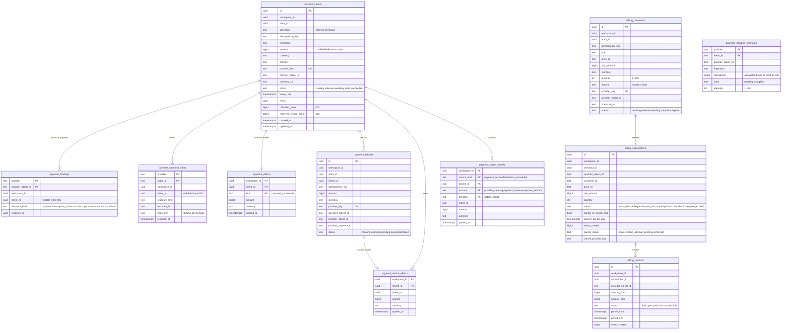

# 09 — ERD

จาก migrations `001-payments`, `002-billing-refunds`, `003-ledger` (namespace `platform_payment`, ประวัติใน `platform_schema_migrations` ของ core)
FK ทุกตัวเป็นแบบ composite `(workspace_id, id)` เพื่อไม่ให้อ้างข้าม workspace ได้

Sources: `src/platform_payment/migrations.py`, `billing_migrations.py`, `ledger_migrations.py`

## Constraints, triggers และ RLS

| ตาราง | Unique / check สำคัญ | Trigger | RLS policy |
|---|---|---|---|
| `payment_intents` | `UNIQUE(workspace_id, operation, idempotency_key)`; `payment_refund_balance`: refunded + reserved ≤ amount | — | `payment_intent_workspace` |
| `payment_bindings` | PK `(provider, provider_object_id)` | — | `payment_binding_workspace` + `payment_binding_route` (SELECT ด้วย `app.payment_provider` + `app.payment_object`) |
| `payment_webhook_inbox` | PK `(provider, event_id)` | — | `payment_inbox_workspace` |
| `payment_effects` | PK `(workspace_id, intent_id, kind)` | `payment_effect_no_change` (UPDATE/DELETE raise) | `payment_effect_workspace` |
| `billing_checkouts` | `UNIQUE(workspace_id, idempotency_key)`; `unit_amount*quantity ≤ 999999999` | — | `workspace_isolation` |
| `billing_subscriptions` | `UNIQUE(workspace_id, checkout_id)`, `UNIQUE(provider, provider_object_id)` | — | `workspace_isolation` |
| `billing_invoices` | `UNIQUE(provider, provider_object_id)`; `period_end ≥ period_start` | — | `workspace_isolation` |
| `payment_refunds` | `UNIQUE(workspace_id, intent_id, idempotency_key)` | — | `workspace_isolation` |
| `payment_refund_effects` | PK `(workspace_id, refund_id)` | `payment_refund_effect_no_change` | `workspace_isolation` |
| `payment_pending_webhooks` | PK `(provider, event_id)`; `pg_column_size(normalized) ≤ 65536` | — | `verified_provider_event`: provider + exact event id, หรือ `app.payment_replay='true'` (อ่าน) |
| `payment_ledger_entries` | PK 5 คอลัมน์ | `payment_ledger_balanced` (statement, balance + refund ≤ revenue), `payment_ledger_no_change`, `payment_ledger_no_truncate` | `workspace_isolation` |

ทั้ง 11 ตาราง ENABLE + FORCE RLS; runtime role ต้องเป็น NOSUPERUSER NOBYPASSRLS (core `Database._configure`) และได้ grant ตาม `READINESS_PERMISSIONS` ใน `app.py` (ไม่มี DELETE/TRUNCATE)

Sources: `src/platform_payment/migrations.py`, `billing_migrations.py`, `ledger_migrations.py`, `app.py`, platform-backend-core `21d5f44` `db.py`, `docs/runtime.md` §Effective runtime grants

## Open questions

- ไม่มี retention/pruning ของ `payment_pending_webhooks` และ `payment_webhook_inbox` (`docs/billing-runtime.md`: "no destructive pruning is enabled by this pilot")
- hosted Neon apply migration ครบ 001–003 แล้วหรือยัง: `/readyz` 503 ไม่บอกเหตุผล (ตั้งใจไม่บอก) และ ops record บอกแค่ว่า local `/readyz` 200 ด้วย test-mode provider
