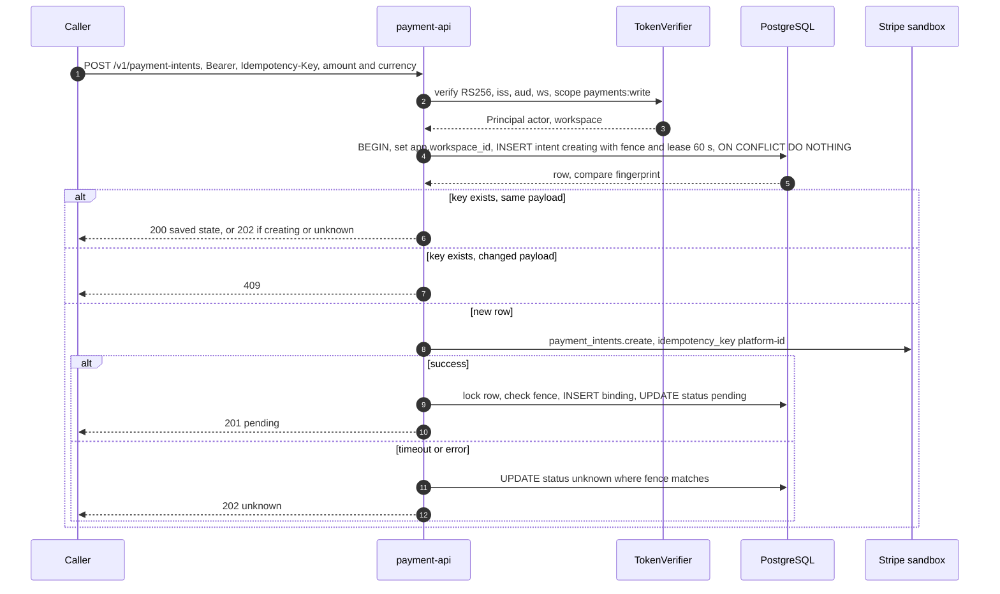
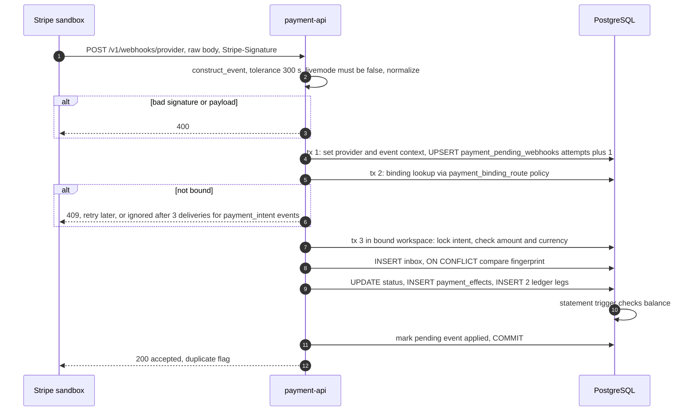
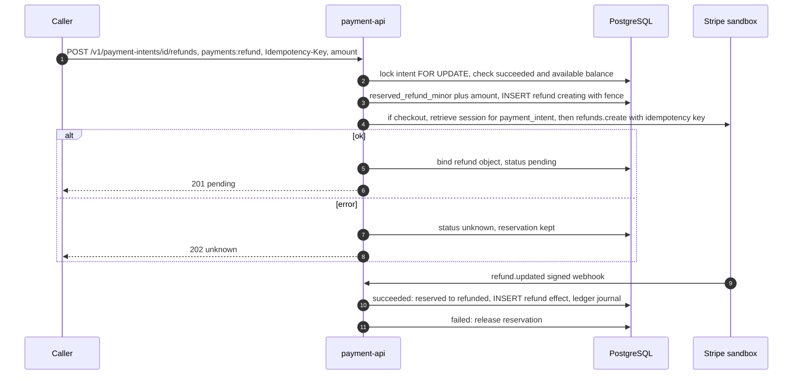
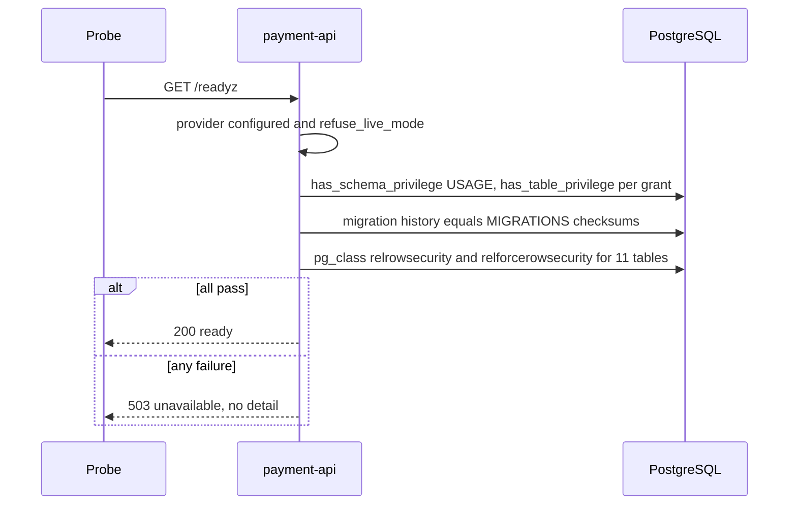

# 10 — Sequence diagrams

## S1 — Create payment intent (idempotent, ambiguity-safe)

Sources: `src/platform_payment/app.py` (`create_payment`, `perform`), `adapters.py` (`StripeProvider.create`), `storage.py`, platform-backend-core `21d5f44` `auth.py`, `db.py`

## S2 — Verified webhook to settlement and ledger

Sources: `src/platform_payment/app.py` (`webhook`, `process_event`), `adapters.py` (`verify_event`), `event_router.py`, `pending_webhooks.py`, `payment_events.py`, `billing_events.py` (`lookup`), `ledger.py`, `ledger_migrations.py`

## S3 — Refund with reservation

Sources: `src/platform_payment/refunds.py`, `provider_operations.py`, `stripe_billing.py` (`create_refund`), `stripe_events.py`, `ledger.py`

## S4 — Readiness probe

Sources: `src/platform_payment/app.py` (`readiness`, `READINESS_PERMISSIONS`)
