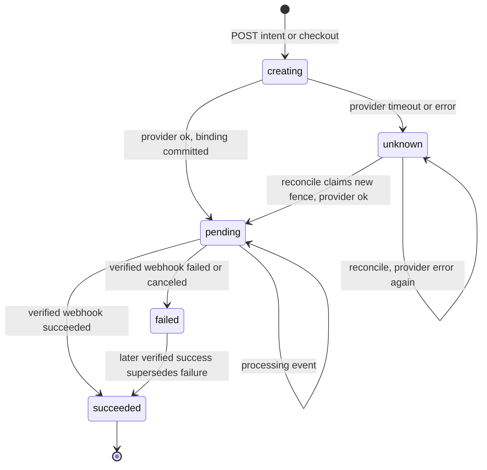
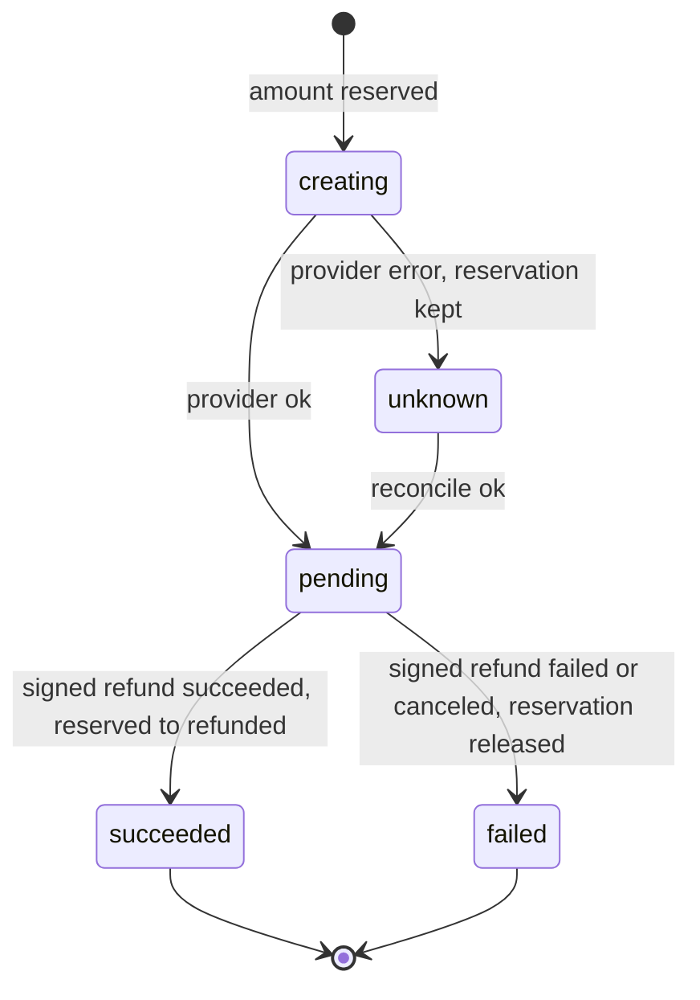
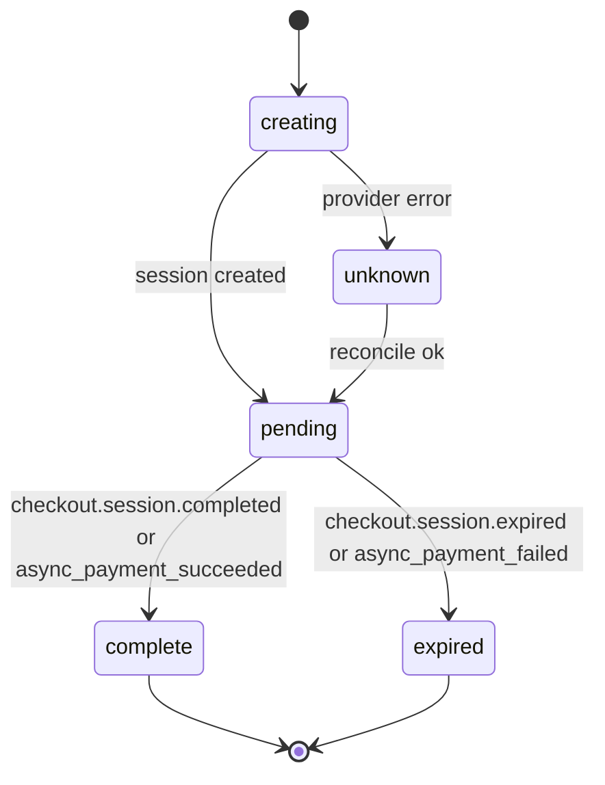
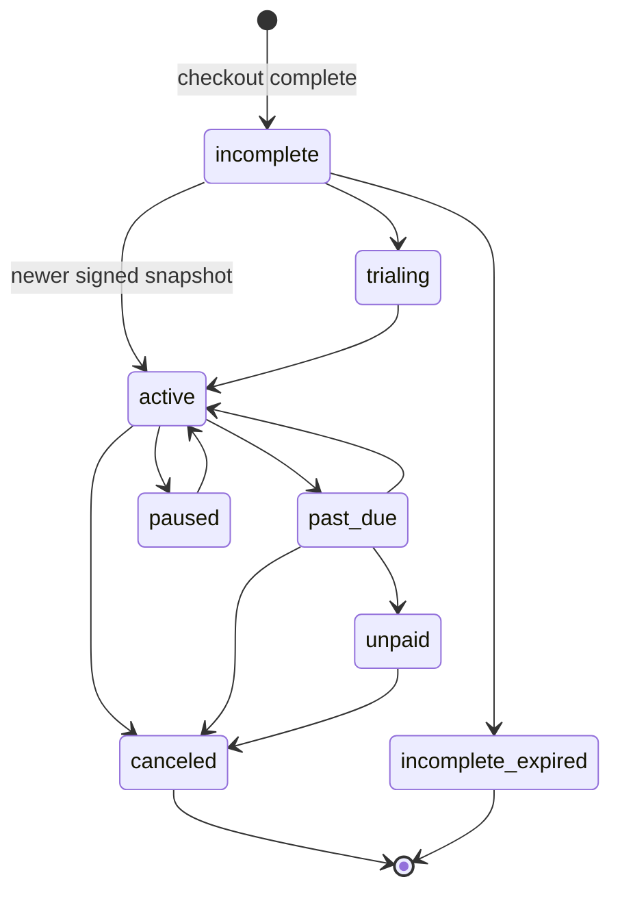
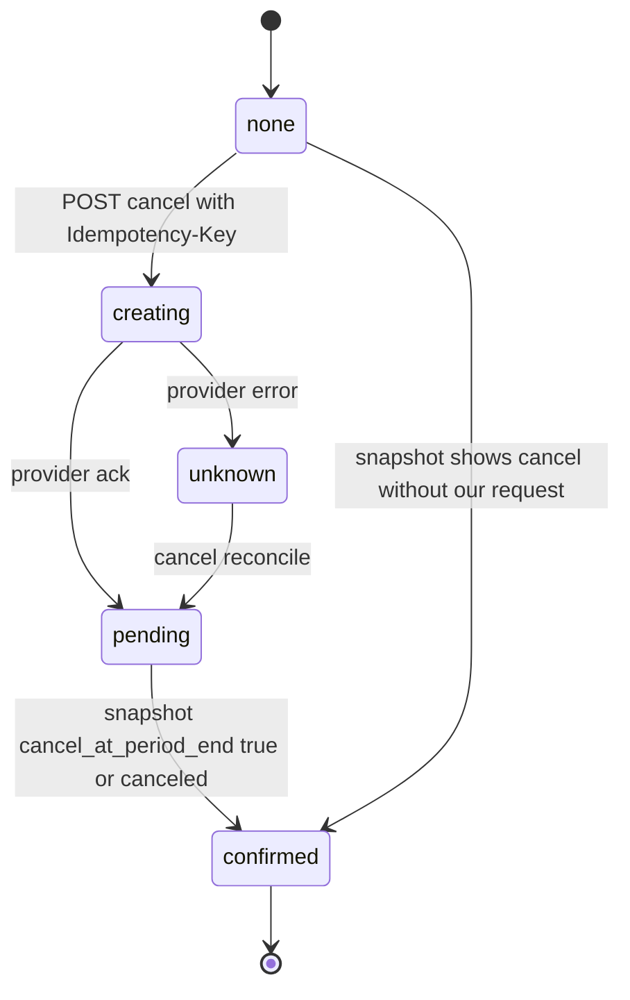
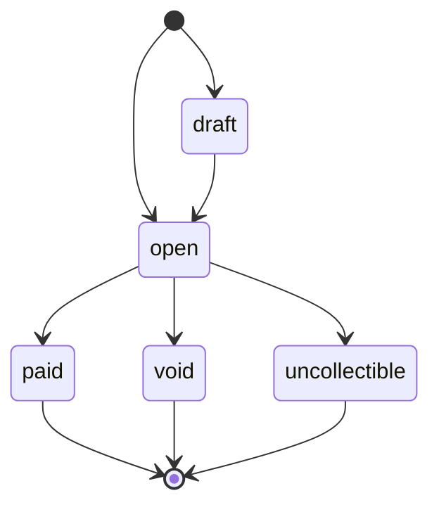
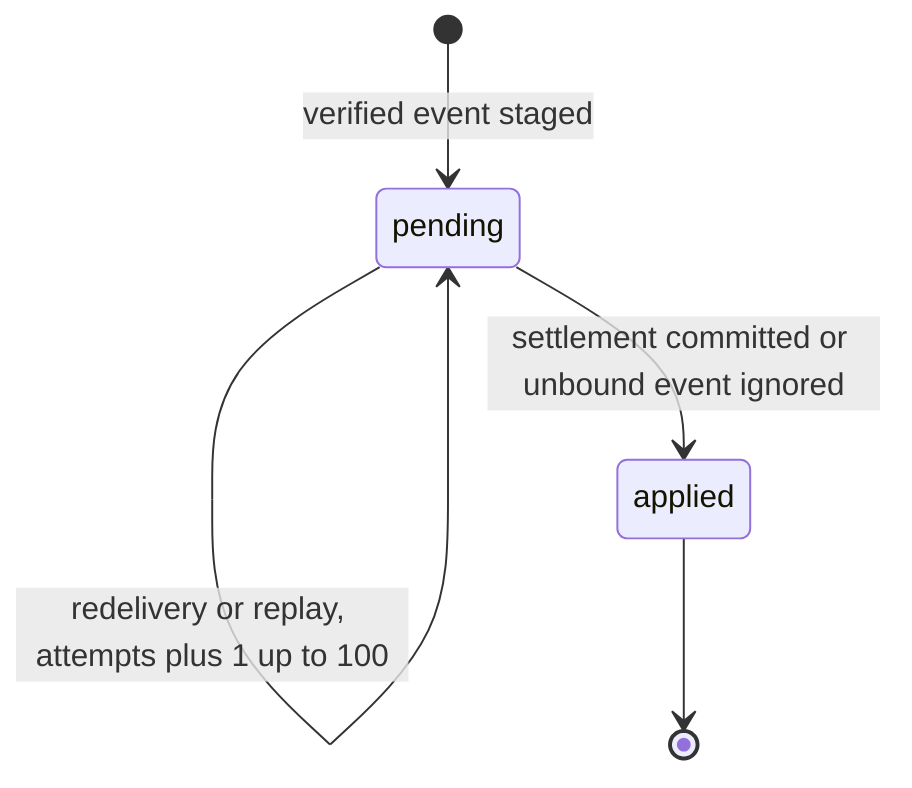

# 11 — State machines

## payment_intents.status

กฎใน `payment_events.handle`: ไม่เปลี่ยนเมื่อ `succeeded` แล้ว; จาก `failed` ไปได้แค่ `succeeded`; reconcile ถูกปฏิเสธเมื่อ `created_at` เกิน 20 ชั่วโมง

Sources: `src/platform_payment/app.py`, `payment_events.py`, `migrations.py` (CHECK)

## payment_refunds.status

Sources: `src/platform_payment/refunds.py`, `provider_operations.py`, `stripe_events.py`, `billing_migrations.py`

## billing_checkouts.status

Sources: `src/platform_payment/billing_checkouts.py`, `provider_operations.py`, `billing_events.py` (`checkout`), `stripe_events.py`

## billing_subscriptions.status และ cancel_status

status ใด ๆ ใน CHECK list เปลี่ยนไปเป็นค่าอื่นได้ตาม snapshot ที่ `created` ใหม่กว่า (ภาพแสดงเส้นทางปกติ ไม่ใช่ข้อจำกัดของโค้ด); `canceled` และ `incomplete_expired` เป็น terminal; snapshot เวลาเดียวกันที่ขัดกัน → 409

Sources: `src/platform_payment/subscriptions.py`, `billing_events.py` (`subscription`), `billing_migrations.py`

## billing_invoices.status

paid/void/uncollectible เป็น terminal; late `draft` ไม่แทน `open` ได้; `paid` ต้อง amount_paid = amount_due

Sources: `src/platform_payment/billing_events.py` (`invoice`), `billing_migrations.py`

## payment_pending_webhooks.state

replay อัตโนมัติหยุดเมื่อ attempts ≥ 20

Sources: `src/platform_payment/pending_webhooks.py`, `payment_events.py` (`ignore_unbound`), `billing_migrations.py`
