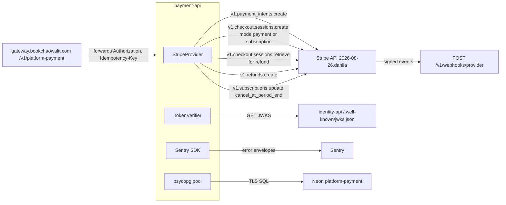

# 12 — API and integrations

ตารางเต็มของ request/response bounds อยู่ใน [`API.md`](../../API.md) และ [`docs/runtime.md`](../runtime.md) / [`docs/billing-runtime.md`](../billing-runtime.md) (reused); ด้านล่างคือ route ทุกตัวจาก router code

## Routes

| Method | Path | Auth / scope | Idempotency | Status codes ที่โค้ดคืน |
|---|---|---|---|---|
| GET | `/healthz` | public | — | 200 |
| GET | `/readyz` | public | — | 200 / 503 |
| GET | `/metrics` | **public** (core) | — | 200 Prometheus text |
| GET | `/openapi.json`, `/docs` | **public** (FastAPI defaults; core `FastAPI(...)` ไม่ปิด `docs_url`/`openapi_url`) | — | 200 |
| POST | `/v1/payment-intents` | `payments:write` | `Idempotency-Key` 1..128 required; scope = workspace + `intent` + key | 201 / 200 replay / 202 creating or unknown / 409 changed payload / 503 no provider |
| POST | `/v1/checkout` | `payments:write` | same, operation `checkout` | same |
| POST | `/v1/payment-intents/{id}/reconcile` | `payments:write` | reuses saved `provider_key`; fenced 60 s lease | 200 / 202 leased or unknown / 409 provider changed or > 20 h / 404 |
| GET | `/v1/payment-intents` | `payments:read` | — | 200 (limit 1..100, offset 0..10000) |
| GET | `/v1/payment-intents/{id}` | `payments:read` | — | 200 / 404 |
| POST | `/v1/webhooks/provider` | Stripe-Signature over raw body, 300 s | provider event id + raw-body SHA-256 | 200 / 400 / 409 unbound, mismatch or changed payload / 500 posting fault / 503 no provider |
| POST | `/v1/billing/checkouts` | `billing:write` | `Idempotency-Key`; workspace + key; plan snapshot | 201 / 200 / 202 / 409 / 422 unknown plan or total / 503 no catalog or provider |
| GET | `/v1/billing/checkouts/{id}` | `billing:read` | — | 200 / 404 |
| POST | `/v1/billing/checkouts/{id}/reconcile` | `billing:write` | saved key, fenced lease | 200 / 202 / 409 |
| GET | `/v1/subscriptions` | `billing:read` | — | 200 |
| GET | `/v1/subscriptions/{id}` | `billing:read` | — | 200 / 404 |
| POST | `/v1/subscriptions/{id}/cancel` | `billing:write` | `Idempotency-Key`; one cancel operation per subscription | 200 / 202 / 409 other key already reserved |
| POST | `/v1/subscriptions/{id}/cancel/reconcile` | `billing:write` | saved `cancel_provider_key` | 200 / 202 / 409 |
| GET | `/v1/invoices` | `billing:read` | — | 200 |
| GET | `/v1/invoices/{id}` | `billing:read` | — | 200 / 404 |
| POST | `/v1/payment-intents/{id}/refunds` | `payments:refund` | `Idempotency-Key`; workspace + intent + key | 201 / 200 / 202 / 409 not refundable or over balance |
| GET | `/v1/payment-intents/{id}/refunds` | `payments:read` | — | 200 |
| GET | `/v1/refunds/{id}` | `payments:read` | — | 200 / 404 |
| POST | `/v1/refunds/{id}/reconcile` | `payments:refund` | saved key, fenced lease | 200 / 202 / 409 |

ทุก route ที่ต้อง token: 401 token ผิด, 403 ไม่มี scope, 404 ID ของ workspace อื่น, 422 body มี field แปลกหรือชนิดผิด (core แปลง validation error เป็น `{"detail":"invalid request"}`); body > 1 MiB → 413; > 30 s → 504

CLI: `python -m platform_payment serve | migrate | replay-webhooks [--limit N]` (N 1..100)

Sources: `src/platform_payment/app.py`, `billing_checkouts.py`, `subscriptions.py`, `refunds.py`, `provider_operations.py`, `__main__.py`, platform-backend-core `21d5f44` `http.py`, `API.md`

## External integrations

| Integration | Library / protocol | Bounds ในโค้ด |
|---|---|---|
| Stripe | `stripe==14.4.1`, `StripeClient`, `HTTPXClient(timeout=5)`, `max_network_retries=1` | test keys only; `integration_identifier` `platform_checkout_kqzmpvtn` / `platform_billing_kqzmpvtn`; no automatic tax |
| Stripe webhook events | `stripe.Webhook.construct_event(tolerance=300)` | payment_intent.succeeded / payment_failed / canceled / processing; checkout.session.completed / async_payment_succeeded / async_payment_failed / expired; customer.subscription.created / updated / deleted; invoice.created / finalized / updated / paid / payment_succeeded / payment_failed / voided / marked_uncollectible; refund.created / updated / failed; อื่น ๆ ignored |
| platform-identity | JWKS HTTPS, no redirect, 1 MiB, ≤ 64 keys | refresh ≤ 1 ครั้ง / 60 s |
| Neon PostgreSQL | `psycopg_pool`, max 8 (`DATABASE_POOL_MAX`) | statement timeout 10 s, pool wait 20 s, connect 15 s |
| Sentry | `sentry-sdk>=2.72,<3` | errors only (ADR-0008) |
| Edge gateway | HTTPS proxy | ต้อง Bearer; ไม่ forward `Stripe-Signature` → webhook ต้องเข้า Railway URL ตรง |

Sources: `src/platform_payment/adapters.py`, `stripe_billing.py`, `stripe_events.py`, `_sentry.py`, `pyproject.toml`, `docs/billing-runtime.md` §Subscription and invoice events, platform-backend-core `21d5f44` `auth.py`, `db.py`, platform-api-gateway `c7b16d1` `src/book_api_gateway/edge.py`, `routes.json`

## Open questions

- `/metrics`, `/openapi.json` และ `/docs` ตอบ 200 แบบไม่ต้อง auth บน `https://payment-api-production-3a91.up.railway.app` (probe 2026-11-03); `docs/runtime.md` บอกให้ "secure it through ingress" แต่ Railway URL เปิดตรง ไม่มี ingress กั้น — ตั้งใจหรือไม่
- `POST /v1/webhooks/provider` ตอบ 503 ตอนนี้ (ไม่มี provider config; probe 2026-11-03)
