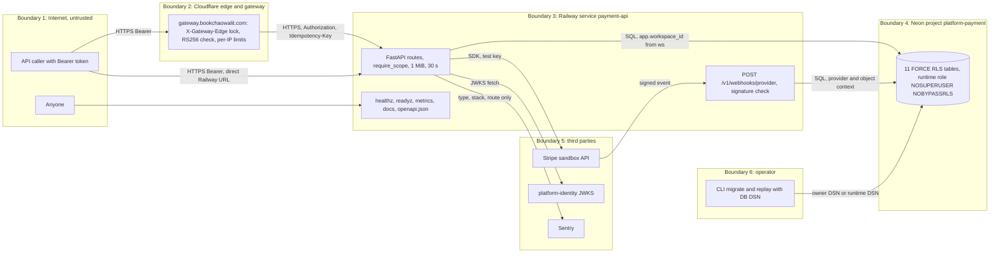

# 13 — Threat model

ขอบเขต: runtime ตามที่ hosted บน Railway วันที่ 2026-11-03 (test mode, `/readyz` 503 เพราะไม่มี sandbox key) และตามโค้ดเมื่อ config ครบ
central attack-path pack: [ATTACK-PATH-DIAGRAMS.md](https://github.com/bookchaowalit/architecture-docs/blob/main/docs/architecture/ATTACK-PATH-DIAGRAMS.md) (ไม่มีหัวข้อเฉพาะ payment)

## DFD

Sources: `src/platform_payment/app.py`, `adapters.py`, `storage.py`, `pending_webhooks.py`, `billing_events.py` (`lookup`), `migrations.py`, `billing_migrations.py`, `ledger_migrations.py`, `_sentry.py`, `__main__.py`, platform-backend-core `21d5f44` `http.py`, `auth.py`, `db.py`, platform-api-gateway `c7b16d1` `API.md` + `src/book_api_gateway/edge.py`, probes 2026-11-03 (`/metrics`, `/docs`, `/openapi.json` 200 on the Railway URL)

## STRIDE ต่อ element

| Element | Threat | Mitigation ที่พบในโค้ด | Gap |
|---|---|---|---|
| Bearer token (API) | **S** forged / replayed token | RS256 only, exact `iss`/`aud` (`payment-api`), required `sub ws iat exp jti`, lifetime ≤ 3600 s, reject `del`/`obo`, JWKS HTTPS no redirect | ไม่มี revocation หรือ `jti` replay cache ใน service |
| Tenant data | **I** / **E** cross-workspace read/write | `ws` only authority; FORCE RLS ทุกตาราง; composite FK `(workspace_id, id)`; core ปฏิเสธ SUPERUSER/BYPASSRLS role; 404 for foreign IDs | — (มี test จริงบน PostgreSQL) |
| Scopes | **E** read client creates money movement | `require_scope` per route; hub ได้แค่ `payments:read`, `billing:read` | ไม่มี per-actor limit หรือ approval สำหรับ refund |
| Payment creation | **T** client chooses price / URL | amount/currency validated (strict int, allowlist currency); subscription price from server catalog; return URLs server-owned HTTPS | one-time amount ยังมาจาก caller (ตามการออกแบบ) |
| Idempotency | **T** duplicate charge on retry | durable key + fingerprint, provider idempotency key, fenced lease, 20 h cutoff | manual reconciliation หลัง 20 h ไม่มี tooling |
| Webhook | **S** forged settlement | raw-body Stripe signature, 300 s tolerance, `livemode` must be false, binding by exact object id, amount/currency equality, event id + SHA-256 dedupe | endpoint ต้องเข้า Railway URL ตรง (gateway ไม่ forward `Stripe-Signature`); ไม่มี IP allowlist |
| Webhook | **D** flood | body 1 MiB, normalized ≤ 60 KB, unsigned → 400 ก่อนแตะ DB | ไม่มี rate limit ใน service |
| Pending spool | **I** tenant lists unbound events | RLS `verified_provider_event`; replay context ตั้งได้เฉพาะ CLI | ไม่มี retention policy |
| Ledger | **T** edit history, over-refund | append-only triggers, statement balance trigger, `payment_refund_balance` CHECK, refund reservation under row lock | — |
| Live money | **E** run against live Stripe | `refuse_live_mode` at startup, CLI, every `/readyz`; test keys only; live events 400 | Infisical `/stripe` เก็บแต่ live keys (ops record) — code ปฏิเสธแต่ human error ยังเป็นไปได้ |
| Public probes | **I** service fingerprinting | `/readyz` 503 without detail; metrics use route templates only | `/metrics`, `/docs`, `/openapi.json` public on Railway URL (`docs/runtime.md`: secure metrics through ingress) |
| Logs | **I** secrets in logs | uvicorn access log off; core logs route, status, correlation id only; errors never include config values | Railway log retention ไม่ได้ตรวจ |
| Sentry egress | **I** PII / secrets | no tracing, no locals, no request data, no free text (`_scrub_event`); `SENTRY_DSN` is set on Railway | — |
| Operator CLI | **E** / **R** | live-key refusal exit 2; replay bounded 1..100, attempts < 20; errors redacted | ไม่มี audit event ของ operator action; DB credential = trusted infrastructure |
| Repudiation (API) | **R** | `actor_id` on intents, refunds, checkouts; `x-request-id` per response | ไม่มี audit write ไป `security-api` (`depends_on: security` แต่ไม่มีโค้ดเรียก) |
| Container / supply chain | **T** | non-root UID 65532, multi-stage no build tools, SHA-pinned actions, core pinned commit, `stripe==14.4.1`, `uv.lock`, shared security workflow | — |

Sources: ตามตาราง DFD ข้างบน + `runtime_tests/test_api.py`, `test_readiness_grants.py`, `test_live_mode.py`, `test_sentry.py`, `.github/workflows/check.yml`, `Dockerfile`, Railway variable names (2026-11-03), ops record: book-platforms-status (2026-11-03)

## Open questions

- service ควรปฏิเสธ request ที่ไม่ผ่าน gateway หรือไม่ (ตอนนี้ Railway URL เปิดตรงและ JWT เป็นด่านเดียว)
- ต้องการ audit event ไป platform-security สำหรับ refund / cancel หรือไม่
- independent payment/security review ก่อน live (`docs/runtime.md` §Deployment and rollback gates) ยังไม่ได้ทำ
