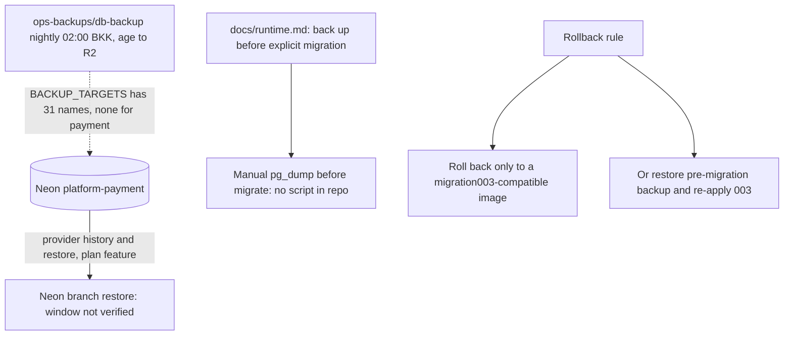

# 14 — Backup and DR

## ข้อมูลที่มีและอยู่ที่ไหน

| Data | ที่เก็บ | ความสำคัญ |
|---|---|---|
| intents, bindings, inbox, effects | Neon project `platform-payment` (floral-union-19598731) | idempotency + dedupe history: ห้ามหาย ไม่งั้น retry อาจสร้าง provider object ซ้ำ |
| billing checkouts, subscriptions, invoices | Neon เดียวกัน | mirror ของ Stripe (สร้างใหม่ได้บางส่วนจาก provider) |
| refunds + reservations, refund effects | Neon เดียวกัน | balance ของเงินคืน |
| `payment_ledger_entries` | Neon เดียวกัน | journal; สร้างใหม่ได้จาก effect rows ด้วย backfill ของ migration 003 |
| `payment_pending_webhooks` | Neon เดียวกัน | event ที่ verify แล้วแต่ยังไม่ apply |
| config / secrets | Railway variables; Infisical `/platform-payment` | — |
| image | สร้างใหม่จาก `Dockerfile` ที่ commit ใดก็ได้ | — |

ตอนนี้ hosted DB น่าจะยังไม่มีธุรกรรม เพราะ `/readyz` 503 และ creation/webhook ตอบ 503 เมื่อไม่มี provider config (probe 2026-11-03)

## Backup / restore reality

Sources: `docs/runtime.md` §Deployment and rollback gates + §Ledger rollback + §Staging plan step 8, `docs/billing-runtime.md` §Compatibility and migration + §Durable events, `src/platform_payment/ledger_migrations.py`, ops record: book-platforms-status (2026-11-03), central [ADR-0002 production baseline](https://github.com/bookchaowalit/architecture-docs/blob/main/docs/architecture/decisions/ADR-0002-production-baseline-monitoring-backups.md), platform-db-backup `27a0a68` `README.md` (`BACKUP_TARGETS`), Railway API read 2026-11-03 of `ops-backups/db-backup` `BACKUP_TARGETS` (31 names, no payment target)

## RTO / RPO

- RTO: **not defined**
- RPO: **not defined**
- Restore drill: ไม่มี (staging plan ข้อ 8 "Rollback rehearsal" ยังไม่ได้รัน)

## Gaps

- DB ของ payment ไม่อยู่ใน nightly encrypted backup (`BACKUP_TARGETS` ของ `ops-backups/db-backup` ไม่มี target ของ payment)
- ไม่มี script backup ก่อน migrate ใน repo
- backfill ของ migration 003 ยังไม่ได้พิสูจน์กับ schema owner ที่ไม่ใช่ superuser (`docs/runtime.md` "Not proven here")

## Open questions

- จะเพิ่ม `platform-payment` เข้า `BACKUP_TARGETS` (พร้อม role `db_backup` ใน Neon project) ก่อนเปิด sandbox traffic หรือไม่
- Neon free plan history retention ของ project นี้เท่าไร (ไม่ได้ตรวจ)
- เป้าหมาย RTO/RPO ของ payment
