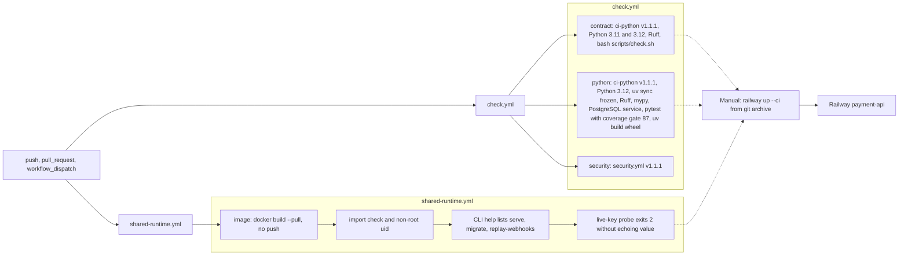

# 15 — CI/CD pipeline

workflows ทั้งสองรันบน `push` (ทุก branch), `pull_request` และ `workflow_dispatch`; `permissions: contents: read`; concurrency ต่อ ref แบบ cancel-in-progress
ไม่มี job ใด deploy: deploy เป็นขั้น manual `railway up` (ดู 16, 18)

| Job | Uses | Notes |
|---|---|---|
| `contract` (matrix 3.11, 3.12) | `bookchaowalit/platform-ci-workflows/.github/workflows/ci-python.yml@87dc5e1c` (v1.1.1) | `install-command: "true"`, `test-command: bash scripts/check.sh` (schema, pin, unittest `tests/`) |
| `python` | same reusable workflow | `postgres: true`, `coverage-threshold: "87"` (measured 87.06% 2026-11-03), `PLATFORM_TEST_DSN="$DATABASE_URL" python -m pytest -q --cov`, `uv build --wheel` |
| `security` | `security.yml@87dc5e1c` (v1.1.1) | shared scan (gitleaks ตาม `docs/runtime.md`) |
| `image` | `actions/checkout@11d5960a` (v4) | build-only, 15 min timeout |

Sources: `.github/workflows/check.yml`, `.github/workflows/shared-runtime.yml`, `scripts/check.sh`, `pyproject.toml`, `tests/test_build_hygiene.py`, `docs/runtime.md` §Container image + §Verification 2026-10-29, ops record: book-platforms-status (2026-11-03) (deploy recipe)

## Open questions

- รายละเอียด step ภายใน `ci-python.yml` / `security.yml` v1.1.1 อยู่ใน repo `platform-ci-workflows` (ไม่ได้อ่านในรอบนี้)
- ไม่มี CD; ควรมี deploy job หรือ deploy-smoke หลัง `railway up` หรือไม่
