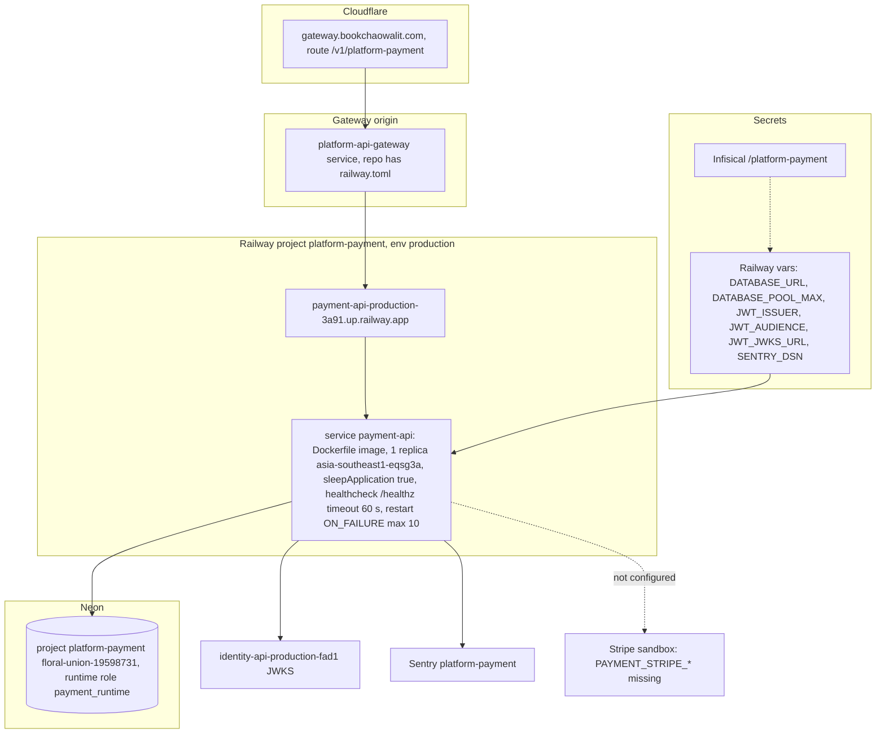

# 16 — Deployment

| Item | Value | Source |
|---|---|---|
| Deployment | 1 deployment 2026-11-03 08:13 UTC, reason `deploy`, CLI upload (no commit hash), status now `SLEEPING` | Railway API read 2026-11-03 |
| `/healthz` | 200 (2.8 s cold) | probe 2026-11-03 |
| `/readyz` | 503: provider not configured (no `PAYMENT_STRIPE_API_KEY`, `PAYMENT_STRIPE_WEBHOOK_SECRET`, `PAYMENT_SUCCESS_URL`, `PAYMENT_CANCEL_URL`) | probe + Railway variable names 2026-11-03, `app.py` `readiness` |
| Plan catalog | `PAYMENT_PLAN_CATALOG_JSON` not set → subscription checkout/cancel 503 | Railway variable names, `catalog.py` |
| Port | `PORT` 8080 in image | `Dockerfile` |
| Sleep | Railway serverless sleep; core pool waits 20 s for Neon resume | Railway API, platform-backend-core `21d5f44` `db.py` |
| Monitoring | not in platform-uptime-worker targets (`a26e7dc` `src/targets.ts`) | ops record: "then add to uptime-worker" |

Sources: `Dockerfile`, `src/platform_payment/__main__.py`, `config.py`, `catalog.py`, `app.py`, `API.md`, Railway API read 2026-11-03 (service instance, deployment meta, variable **names** only), probes 2026-11-03, platform-api-gateway `c7b16d1` `routes.json`, platform-uptime-worker `a26e7dc` `src/targets.ts`, ops record: book-platforms-status (2026-11-03)

## Open questions

- owner ต้องตั้ง Stripe sandbox key + webhook secret + return URLs (ops record: owner follow-up)
- `SENTRY_ENVIRONMENT` ไม่ได้ตั้ง → ใช้ default `production` ในขณะที่ service เป็น test mode
- custom domain สำหรับ payment ไม่มี (ใช้ `*.up.railway.app` + gateway)
