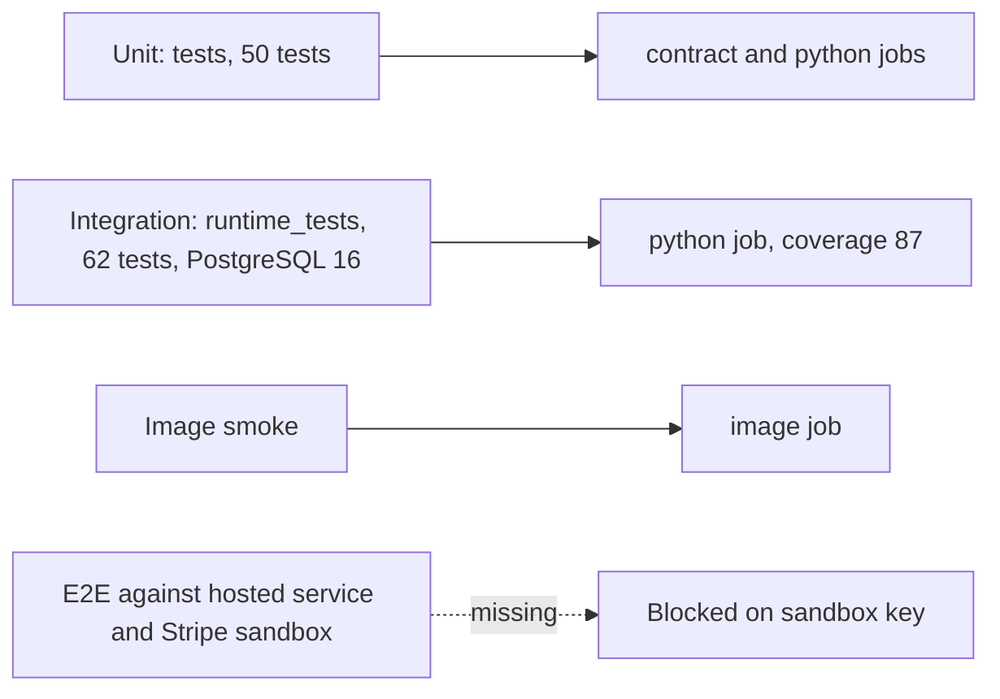

# 17 — Test coverage matrix

ระดับ: **unit** = `tests/` (stdlib unittest, ไม่มี DB); **integration** = `runtime_tests/` (PostgreSQL จริงผ่าน `PLATFORM_TEST_DSN`, fake provider หรือ Stripe SDK จริงที่ intercept transport); **e2e** = เรียก service ที่ deploy แล้ว + Stripe sandbox จริง (ไม่มี)
CI: unit ใน `contract` + `python`; integration ใน `python` (PostgreSQL 16, coverage gate 87%); image smoke ใน `image`

| Feature | Unit | Integration | E2E / sandbox | Gap |
|---|---|---|---|---|
| Contract schema, pin, registry drift | `test_contract_check.py` (19), `test_drift_checks.py` (17) | — | — | — |
| Boundary rules (auth declared, gates, no secrets) | `test_payment_boundary.py` (6) | — | — | — |
| Build hygiene, image, SHA pins | `test_build_hygiene.py` (8) | `image` job (docker build + probes) | — | — |
| Intent / checkout creation, idempotency, tenant isolation | — | `test_api.py` (14) | none | real sandbox |
| Webhook signature, raw body, livemode, checkout payment_status | — | `test_api.py` | none | real Stripe signatures |
| Concurrency, two pools, reconcile, 20 h cutoff | — | `test_api.py`, `test_billing.py` | none | — |
| Readiness grants + RLS | — | `test_api.py`, `test_readiness_grants.py` (3) | `/readyz` probe only (503) | hosted grants unproven while 503 |
| Subscription checkout, lifecycle, invoices, cancel | — | `test_billing.py` (11), `test_stripe_billing.py` (2) | none | plan/catalog parity in sandbox |
| Refund reservation and settlement | — | `test_refunds.py` (5) | none | — |
| Ledger balance, append-only, rollback, backfill | — | `test_ledger.py` (7) | none | non-superuser backfill |
| Pre-binding spool + operator replay | — | `test_billing.py` (`test_events_before_binding_...`) | none | schedule not defined |
| Live-mode refusal | — | `test_live_mode.py` (7), `test_review_fixes.py` (2) | `image` live-key probe | — |
| Sentry scrubbing | — | `test_sentry.py` (11) | none | — |
| Legacy compatibility (`/api/webhook/stripe`, `/api/webhook/revenue`) | — | — | — | parity fixtures (`docs/UPGRADE-PLAN.md` P0) |

จำนวน test นับจาก `def test_` ในแต่ละไฟล์ (unit 50 = 8 + 19 + 17 + 6; integration 62 = 14 + 11 + 7 + 7 + 3 + 5 + 2 + 11 + 2); `docs/runtime.md` บันทึก 132 passed ณ 2026-10-29 (pytest นับ subtests/parametrize ต่างกัน)

Sources: `tests/*.py`, `runtime_tests/*.py`, `runtime_tests/conftest.py`, `pyproject.toml` (`testpaths`, coverage), `.github/workflows/check.yml`, `.github/workflows/shared-runtime.yml`, `docs/runtime.md` §Verification, `docs/verification-2026-10-15.md`
