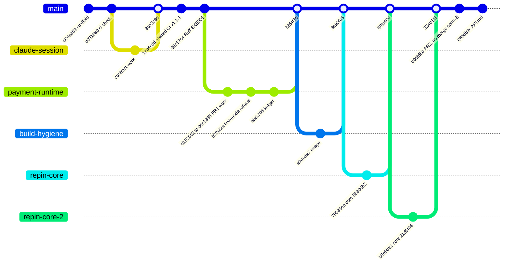
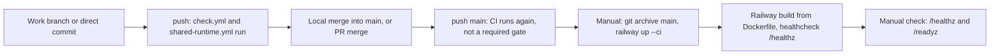

# 18 — Git and release workflow

ข้อเท็จจริงจาก `git log origin/main` และ GitHub API (2026-11-03):

- `main` ไม่มี branch protection (`GET .../branches/main/protection` → 404 "Branch not protected") และไม่มี ruleset (0)
- PR ทั้งหมด 2 ตัว: #1 (`codex/shared-infrastructure-20261015`) **closed ไม่ merge** ภายใต้ D8 แล้วเนื้อหาถูก rebase เป็น branch `payment-runtime` และ merge แบบ local (`bfd4f7d` "Merge test-mode payment runtime with balanced ledger (PR #1)"); #2 (`ci/uv-lock-mypy-sentry`) merged 2026-11-03 04:45 UTC เป็น commit เดียว `b0dfd8d` บน `324b1f8` (ไม่มี merge commit)
- branch อื่นที่ merge แบบ local: `build-hygiene` (`8e90fe5`), `repin-core` (`80fc404`), `repin-core-2` (`324b1f8`), `claude/untitled-session-bhlj06` (`3ba3c8d`)
- commit ตรงบน main ก็มี (เช่น `065db9c` docs API.md)
- ไม่มี tag หรือ GitHub release; version ใน `pyproject.toml` คงที่ `0.1.0`
- deploy ไม่ผูกกับ git: `railway up` จาก `git archive` (ops record deploy recipe), deployment meta ไม่มี commit hash

Sources: `git log --graph origin/main`, `gh pr list -R bookchaowalit-backend/platform-payment --state all`, `gh api repos/bookchaowalit-backend/platform-payment/branches/main/protection`, `gh api .../rulesets`, `.github/workflows/*.yml`, `docs/runtime.md` §Verification 2026-10-29 (rebase of PR #1), Railway API read 2026-11-03, ops record: book-platforms-status (2026-11-03)

หมายเหตุ: gitGraph ย่อ commit ภายใน branch; ลำดับ merge ตรงกับ `git log --merges`

## Open questions

- ควรเปิด branch protection / required checks บน `main` หรือไม่ (repo public, CI บน GitHub-hosted)
- ควร tag release หรือส่ง `SENTRY_RELEASE` ตอน `railway up` เพื่อผูก deploy กับ commit หรือไม่ (`RAILWAY_GIT_COMMIT_SHA` ไม่มีเมื่อ deploy ด้วย CLI)
