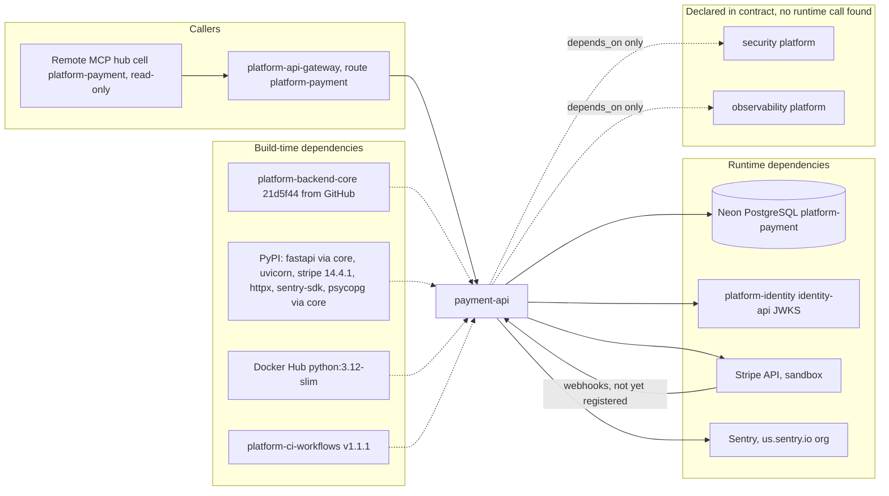

# 19 — Service dependency map

| Dependency | Failure effect (จากโค้ด) |
|---|---|
| Neon | pool wait 20 s / connect 15 s, statement timeout 10 s; `/readyz` 503; routes 500 (redacted) |
| identity JWKS | refresh fail → cache ว่าง 60 s → 401 ทุก token |
| Stripe | 5 s timeout, 1 retry → `unknown` 202, reconcile ภายหลัง; missing config → 503 |
| Sentry | errors only, ไม่กระทบ request |

Sources: `pyproject.toml`, `uv.lock`, `Dockerfile`, `contract.json` (`depends_on`), `src/platform_payment/adapters.py`, `_sentry.py`, `__main__.py`, platform-backend-core `21d5f44` `auth.py`, `db.py`, `.github/workflows/check.yml`, platform-api-gateway `c7b16d1` `routes.json`, ops record: book-platforms-status (2026-11-03) (hub cell, Sentry org on us.sentry.io)

## Open questions

- `depends_on: observability` หมายถึง library instrumentation ใด (ops record: observability เป็น library, ยังไม่มี service; repo นี้ไม่ import)
- MCP hub clone ในเครื่อง (`platform-mcp-remote-worker` `cc8492d`) ยังไม่มี cell `platform-payment`; ops record บอกว่ามีแล้ว — ใช้ ops record เป็นหลัก
