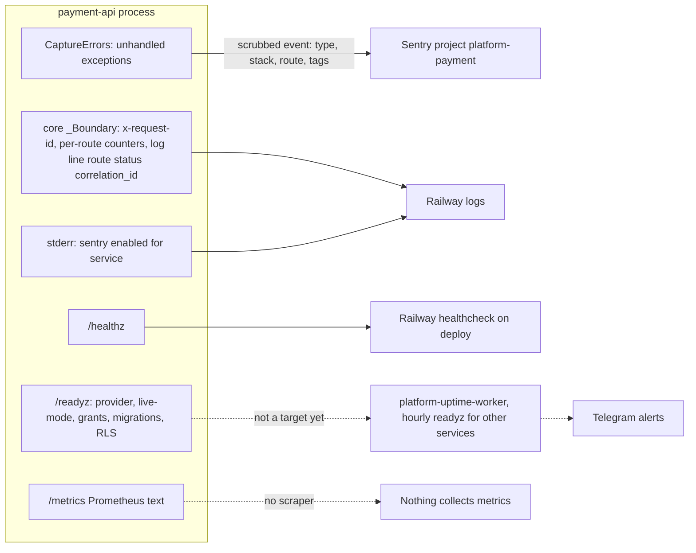

# 20 — Observability

| Signal | Implementation | Watched by |
|---|---|---|
| Errors | `_sentry.py` + `CaptureErrors`, `SENTRY_DSN` set on Railway | Sentry project `platform-payment`; alert rules ไม่ได้ตรวจ |
| Request log | core `_LOG.info('request route=%s status=%d correlation_id=%s')`; uvicorn access log off | Railway logs (ไม่มี alert) |
| Metrics | `platform_http_requests_total{route,status}`, `platform_http_request_duration_seconds_sum` | ไม่มี scraper |
| Liveness | `/healthz` | Railway deploy healthcheck (timeout 60 s) |
| Readiness | `/readyz` | ไม่มี (uptime worker ยังไม่มี target payment) |
| Business health | pending webhook age/count ควร monitor (`docs/billing-runtime.md`) | ไม่มี query / alert |

Sources: `src/platform_payment/_sentry.py`, `__init__.py`, `app.py`, `__main__.py` (`access_log=False`), platform-backend-core `21d5f44` `http.py`, Railway API read 2026-11-03 (variable names, healthcheck), platform-uptime-worker `a26e7dc` `src/targets.ts` (no payment target), `docs/billing-runtime.md` §Durable events, ops record: book-platforms-status (2026-11-03)

## Gaps

- ไม่มี uptime target, heartbeat, หรือ alert ของ pending webhook
- `PRODUCT.md` บอก Sentry "no-op until `SENTRY_DSN` is set ... set the DSN in the change that activates the runtime" แต่ Railway มี `SENTRY_DSN` แล้ว (doc ล้าหลัง)

## Open questions

- Sentry alert rule ของ project `platform-payment` ส่งไปที่ไหน (email / Telegram) — ไม่มีใน repo
