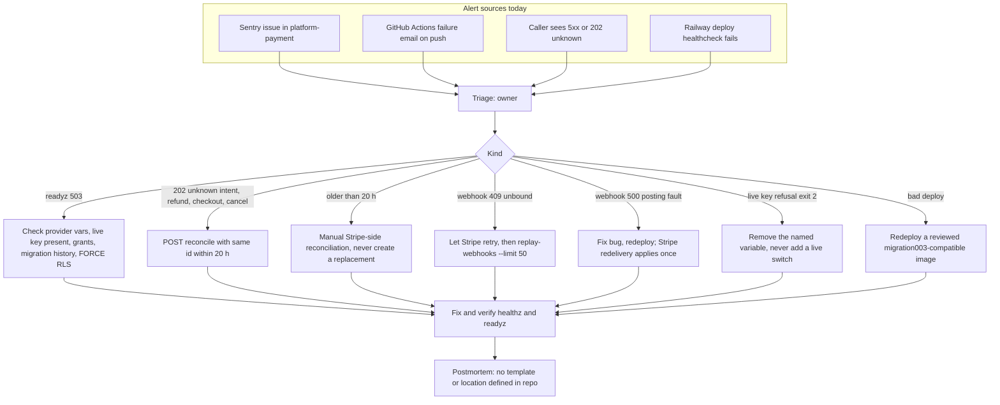

# 21 — Incident response

ไม่มี `RUNBOOK.md` ใน repo; ขั้นตอนด้านล่างประกอบจาก signal ที่มีจริง (ดู 20) และคำสั่ง/กฎใน `docs/runtime.md` + `docs/billing-runtime.md`

Sources: `docs/runtime.md` §API, idempotency and ambiguous outcomes + §Deployment and rollback gates + §Ledger rollback, `docs/billing-runtime.md` §Durable events, `src/platform_payment/app.py`, `live_mode.py`, `pending_webhooks.py`, `__main__.py`, `_sentry.py`, Railway API read 2026-11-03 (healthcheck), ops record: book-platforms-status (2026-11-03)

## Gaps

- ไม่มี Telegram alert path: service ไม่อยู่ใน uptime worker และไม่มี heartbeat
- ไม่มี runbook / postmortem template ใน repo
- ไม่มี on-call นอกจาก owner

## Open questions

- severity ของ payment incident และเวลาตอบสนองที่ต้องการ
- ใครมีสิทธิ์ทำ manual Stripe-side reconciliation และบันทึกผลที่ไหน
