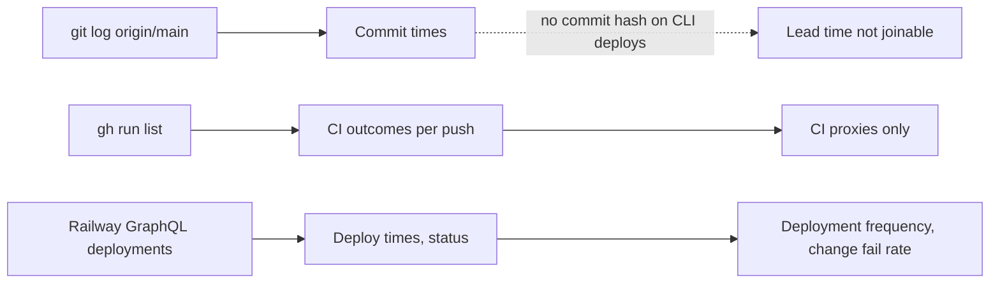

# 22 — DORA metrics

หน้าต่าง: 90 วัน 2026-08-05 → 2026-11-03 (ครอบคลุมประวัติทั้งหมด: commit แรก `604a359` 2026-09-17)
ข้อจำกัดหลัก: deploy ทำด้วย `railway up` (CLI upload) → GitHub ไม่มี deployment record และ Railway deployment meta ไม่มี commit hash ดังนั้น git/gh **บอกไม่ได้** ว่า deploy อะไรเมื่อไร; ข้อมูล deploy มาจาก Railway API เท่านั้น



## ค่าที่คำนวณได้

| Metric | วิธีวัดสำหรับ repo นี้ | ค่า (90 วัน) | สถานะ |
|---|---|---|---|
| Deployment frequency | นับ Railway deployments ของ `payment-api` | **1** deployment (2026-11-03 08:13 UTC, reason `deploy`) | computed (Railway) |
| Lead time for changes | commit time → deploy time ของ commit ที่ถูก deploy | ไม่ทราบ commit ที่ deploy; ถ้า deploy มาจาก `main` ณ เวลานั้น (`b0dfd8d`, committed 04:42 UTC) = **≈ 3 h 31 m** | not computable (proxy only) |
| Change fail rate | deployment ที่ต้อง rollback/hotfix ÷ deployments | **0 / 1** (status ปัจจุบัน `SLEEPING`, ไม่มี redeploy) แต่ `/readyz` 503 เพราะยังไม่ config ไม่ใช่ความล้มเหลวของ change | computed, sample 1 |
| Failed deployment recovery time | เวลาจาก deploy fail → deploy ที่ดี | ไม่มี failed deployment | not applicable |
| Deployment rework rate | deployment ที่เป็นการแก้ deploy ก่อนหน้า ÷ deployments | 0 / 1 | computed, sample 1 |

## CI proxies (จาก gh)

| Proxy | ค่า |
|---|---|
| Commits บน `main` (no merges) | 32 (feat 6, fix 7, docs 5, ci 4, chore 4, build 3, test 2, style 1) + 5 merge commits = 37 |
| Pushes to `main` ที่มี CI run | 14 (`Check`) |
| `Check` failure บน `main` | 3 / 14 = **21%** (1bae21e, 092b8e4 on 2026-10-13; 21cf12c on 2026-10-22) |
| เวลาแก้ CI แดงบน `main` | 2026-10-13: 03:36 → 05:37 UTC ≈ 2 h 1 m; 2026-10-22: 09:41 → 09:44 UTC ≈ 3 m |
| `Shared runtime` บน `main` | 6 / 6 success |

## Commands

```bash
# Commits in window
git log --since=2026-08-05 --no-merges --format='%s' origin/main | cut -d: -f1 | sed 's/(.*//' | sort | uniq -c
git log --since=2026-08-05 --merges --format='%h %ci %s' origin/main

# CI runs
gh run list -R bookchaowalit-backend/platform-payment --limit 200 --created '>=2026-08-05' \
  --json workflowName,event,headBranch,conclusion,createdAt,headSha

# GitHub deployments (returns 0)
gh api repos/bookchaowalit-backend/platform-payment/deployments --jq length

# Railway deployments (read-only GraphQL, CLI token from ~/.railway/config.json)
# query { me { workspaces { projects { edges { node { name services { edges { node { name
#   deployments(first:30) { edges { node { createdAt status meta } } } } } } } } } } } }
```

Sources: `git log origin/main`, `gh run list`, `gh api .../deployments`, Railway API read 2026-11-03, ops record: book-platforms-status (2026-11-03) (deploy recipe `railway up --ci` from `git archive main`)

## Open questions

- จะบันทึก commit SHA ตอน deploy อย่างไร (เช่น `SENTRY_RELEASE` หรือ GitHub deployment ที่สร้างตอน `railway up`) เพื่อให้ lead time คำนวณได้
- นิยาม "failed deployment" สำหรับ service ที่ตั้งใจให้ `/readyz` 503 จนกว่าจะ config
